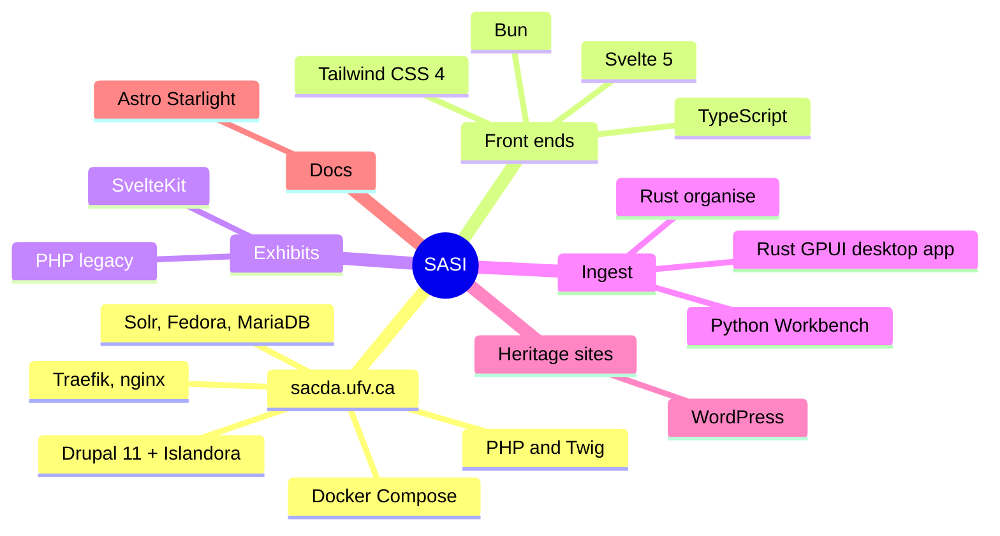

An overview of the tools behind each project. To find every page about one tool, use the
tag links under each page title, or browse [all tags](/docs/tags/).

## By project

| Project | Languages | Main tools | Docs |
|---|---|---|---|
| sacda.ufv.ca (`isle`) | PHP, Twig, YAML, Make, shell | Drupal 11, Islandora 2, isle-buildkit, Docker Compose, Traefik, Solr, Fedora, MariaDB, ActiveMQ | [Architecture](/docs/islandora/start/architecture/) |
| `sacda` theme (`isle-theme`) | TypeScript, CSS, Twig, PHP | Tailwind CSS 4, GSAP, embla-carousel, **Bun** | [Theme guide](/docs/islandora/development/theme/) |
| Fast search, ingest audit | **Svelte 5**, TypeScript, PHP | Vite, Bun, Solr, JSON:API | [Modules](/docs/islandora/development/modules/) |
| `authority_resolver`, place lookup | PHP | Drupal config entities, Drush | [Authorities](/docs/islandora/development/authorities-and-place-lookup/) |
| Exhibits (4 of 6) | **Svelte**, TypeScript | SvelteKit `adapter-static`, Tailwind, GSAP | [Exhibits](/docs/islandora/exhibits/) |
| Exhibits (2 of 6) | PHP, HTML | PHP flattened to static HTML at build time | [Hosting](/docs/islandora/exhibits/hosting/) |
| `sacda-exhibits-common` | **Svelte** | Shared header and footer, GitHub Packages | [Exhibits](/docs/islandora/exhibits/) |
| Matterport tour | Python | `matterport-dl` | [Matterport tour](/docs/islandora/exhibits/matterport-tour/) |
| Ingest | **Python**, **Rust** | Islandora Workbench; `organise` (Rust CLI) | [Workbench](/docs/islandora/workbench/), [Spreadsheet pipeline](/docs/islandora/ingest/sheet-pipeline/) |
| Workbench desktop app | **Rust** | GPUI, gpui-component (in progress) | [Repositories](/docs/islandora/start/repositories/) |
| CollectiveAccess migration | Python, shell | Workbench, CSV tooling | [Migration](/docs/migration/) |
| Thesaurus research | PHP, Docker | Skosmos, VocBench 3 | [Authorities research](/docs/islandora/research/authorities-and-thesaurus/) |
| OCR lab | Python | Tesseract, LLM correction experiments | [Research](/docs/islandora/research/) |
| Heritage websites | PHP | WordPress (LiteSpeed and Apache hosts) | [SACH](/docs/sach/), [CSH](/docs/csh/), [SACLP](/docs/saclp/) |
| These docs | Markdown, Astro | Starlight, Mermaid, Pagefind, Bun, GitHub Pages | [About](/docs/about/) |

## By job

| Job | Tool | Why this one |
|---|---|---|
| Package manager and build runner for JS | **Bun** | Fast, one binary; used for the theme, Svelte apps and these docs. CI runs `bun install --frozen-lockfile`, so commit `bun.lock` |
| Interactive front ends | **Svelte 5** | Small bundles for pages that must stay cheap under load (search) and for exhibits |
| Styling | **Tailwind CSS 4** | Shared with the theme; tokens in `src/css/main.css` |
| Server-side site | **Drupal 11 + Islandora** | Repository features: media, Fedora, IIIF, derivatives |
| Routing and rate limiting | **Traefik v3** | Comes with isle; files hot-reload |
| Static files | **nginx** (`exhibits` container) | Serves exhibits, `/static` and the `/search` shell without PHP |
| Bulk ingest | **Islandora Workbench** (Python) | The standard Islandora ingest tool |
| Sheet preprocessing | **Rust** (`organise`) | A single binary for Linux and Windows lab machines with no Python setup |
| CI/CD | **GitHub Actions**, GHCR, `webhook` | Build the image, then trigger the server |
| Diagrams | **Mermaid** | Written in Markdown, so agents can read them too |

## Versions to know

See [Architecture](/docs/islandora/start/architecture/) for the Drupal, Islandora and
buildkit versions on each environment.

## Adding a tag

Add `tags: [svelte, typescript]` to a page's frontmatter. Use the existing tag names listed
in `src/tags.ts`. A new tag works straight away, but add it to that file too, so it gets a
display name and a description.
