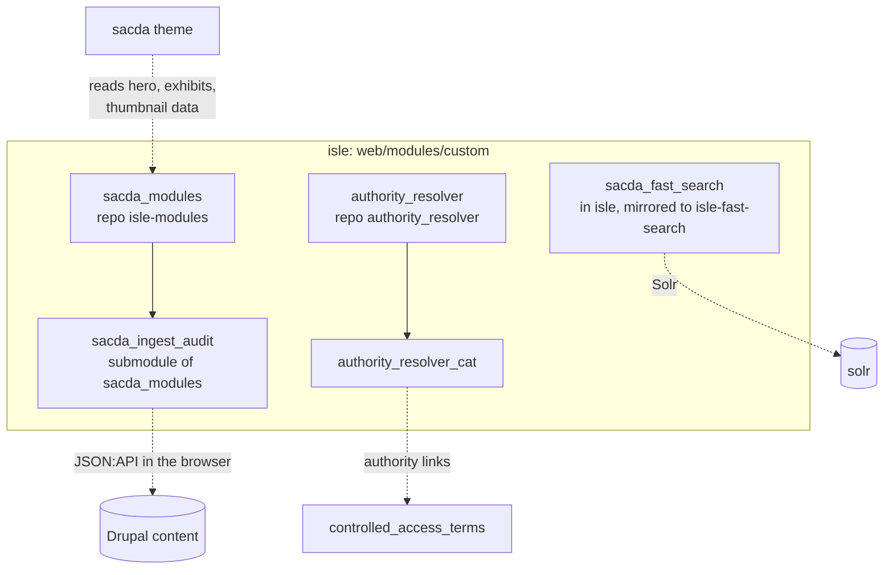

This page is a reference for each custom module. How they ship (submodules, the pointer
bump, CI) is in [Custom code](/docs/islandora/development/custom-code/), and the theme has
its own [Theme guide](/docs/islandora/development/theme/). Everything here reflects `isle`
`main` as of 2026-11.

| Module | Language | Repo | Public pages / routes | Drush |
|---|---|---|---|---|
| `sacda_modules` | PHP, Twig | `isle-modules` | `/admin/structure/sacda-hero`, `/admin/content/places/lookup`, `/api/place-lookup`, `/exhibits/{node}` (dead) | `sacda-place:*`, `sacda:thumbnails:rebuild` |
| `sacda_ingest_audit` | PHP + Svelte | `isle-modules` | `/admin/content/ingest-audit` (+ `/sheet`, `/triage`) | |
| `sacda_fast_search` | PHP + Svelte 5 | `isle` (`isle-fast-search` mirror) | `/search`, `/api/search` | `sacda-fast-search:shell` |
| `authority_resolver` | PHP | `authority_resolver` | `/admin/config/services/authority-sources`, `/authority-resolver/autocomplete` | `authority:*` |
| `skos_export`, `vocbench_sync` | PHP | `islandora-skosmos`, `islandora-vocbench` | DEV only | |

## `sacda_modules`

One module that combines the old `sacda_hero`, `sacda_exhibits` and `sacda_search`. Its
README is titled "SACDA Hero" but covers all of it.

### Heroes

- Config entities `sacda_hero.hero.*`: path (exact URL alias), title, subtitle, media
  UUID, optional image style. They are managed at `/admin/structure/sacda-hero` with the
  permission `administer sacda hero`.
- Heroes are config, so they ship with `drush cex`/`cim`. The **media they point at is
  content** and must exist on the target site. The `pin_hero_media` deploy hook creates
  missing media from theme images.
- `hook_preprocess_page()` sets `sacda_hero`, and the theme's hero macro renders it.
  Matching by path (instead of a field) is deliberate: `/about/team`, `/about/media` and
  `/exhibits` are Views pages with no node.

### Promoted exhibits

The homepage Featured Exhibits come from published Exhibit nodes that are **Promoted to
front page** and have a thumbnail. Sticky exhibits sort first, then the most recently
updated. See [Exhibits](/docs/islandora/exhibits/).

### Place lookup

- `/admin/content/places/lookup`, with `/api/place-lookup` behind it. RAs search Getty TGN
  and CGNDB and see whether the place already exists in `geo_location`.
- Every search is answered from the local mirror table `sacda_place_authority`. Nothing
  calls Getty or NRCan during a search. The mirror is filled by
  `drush sacda-place:sync-authority` and matched to local terms by `sacda-place:sync-local`.
  `sacda-place:status` reports both.
- **Uninstalling the module drops the table.**

See [Authorities and place lookup](/docs/islandora/development/authorities-and-place-lookup/).

### Stored thumbnails

`DiscoverFirstAvailableChildThumbnailSubscriber` gives a collection without its own
thumbnail the first child thumbnail it finds. The result is stored in `sacda_thumbnail`
(`StoredImageDiscovery`), so listings don't walk the tree on every render.

- Rebuild with `drush sacda:thumbnails:rebuild`.
- Saving a node or media clears the stored rows for its ancestors.
- Depends on `dgi_image_discovery`.

### Year range facet widget

`YearRangeWidget`, a facet widget that needs `facets_date_range`.

### Dead code

The Shadow DOM exhibit viewer (`ExhibitController`, `/exhibits/{node}`). Traefik routes
the six real exhibit slugs to nginx before the request reaches it. See
[Exhibits and static files](/docs/islandora/exhibits/hosting/).

### Drush gotcha

Drush 13 finds commands by convention only, and fails silently when the convention isn't
followed. Commands must be in `src/Drush/Commands/*Commands.php` with a namespace ending in
`\Drush\Commands`. Run `drush cr` after adding one.

## `sacda_ingest_audit`

A Svelte page at `/admin/content/ingest-audit` that compares an ingest spreadsheet (CSV,
Excel or a Google Sheets link) with what is in the repository, matched on
`field_identifier`.

- All repository data is read **in the browser** through core JSON:API. The PHP side only
  serves the page and fetches Google Sheets.
- Dependencies: `jsonapi`, `node`, `media`, `taxonomy`.

How to use it: [Ingest audit](/docs/islandora/ingest/ingest-audit/).

## `sacda_fast_search`

A JSON endpoint over the existing Solr index, plus a Svelte 5 front end (`ui/`, built with
Vite by CI) that renders the `/search` page.

- `/search` is the Svelte page. The old Search API view moved to `/search-legacy` with the
  same URL format.
- `/api/search` returns results, facets with counts and totals. It takes the same query
  parameters as `/search` (`f[n]`, `a[n][…]`, `sort_by`, `page`…).
- It reads the view's own configuration (page template, regions, blocks, facets), so it
  stays in step when the view changes.
- `drush sacda-fast-search:shell` writes the static page that nginx serves to anonymous
  visitors. It runs on every deploy.

Measured cost: 0.024 CPU-seconds per request against 0.13 for the view. See
[Search](/docs/islandora/operations/search/).

## `authority_resolver`

A general module, written so it can be published on drupal.org. Its README is the full
reference.

- Authority sources are config entities at `/admin/config/services/authority-sources`.
  Enabled: `lcsh`, `tgm`, `lcgft`, `naf`. Shipped disabled: `wiki`, `aat`, `tgn`.
- **Labels are never resolved during a page render.** They are cached in `authority_record`,
  which survives `drush cr`. Cron refreshes 200 records per run.
- Drush: `authority:scan`, `authority:resolve`, `authority:warm`, `authority:apply`,
  `authority:status`.
- `authority_resolver_cat` writes resolved records onto `controlled_access_terms`
  authority-link fields.
- Set a `user_agent` in settings if id.loc.gov starts throttling.

## In progress

- **`sacda_viewers`**: IIIF Presentation 3 manifests and an audio/video block for the
  media viewers. It is on a branch, not yet on `main`. See
  [Viewers](/docs/islandora/development/viewers/).
- **`skos_export` and `vocbench_sync`** run on DEV only, bind-mounted from their repos.
  See [Authorities and thesaurus research](/docs/islandora/research/authorities-and-thesaurus/).
