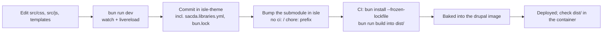

For anyone changing how the site looks: CSS, JS, templates, preprocess code. For adding *content* (team members, exhibits, carousel slides) you usually don't need the theme at all; see [Content Guide](/docs/islandora/editors/content-guide/).

## Stack

- **Tailwind CSS 4** via the Tailwind CLI. There is no PostCSS config; tokens live in `src/css/main.css`.
- **TypeScript**, one file per feature in `src/js/`. Each is bundled with `bun build` as an IIFE into `dist/<name>.js`.
- **GSAP** and **embla-carousel** for animation and carousels.
- **Twig** templates in `templates/`, and PHP preprocess code in `sacda.theme` plus `includes/*.inc`.
- A standalone theme (`base theme: false`). There is no Olivero/Classy underneath, so every template you see is ours or core's default.

## Local setup

1. Get the stack running with the theme bind-mounted into the container:

```
git clone --recurse-submodules git@github.com:south-asian-canadian-digital-archive/isle.git
cd isle
ln -s docker-compose.dev.yml docker-compose.override.yml
make up
```

2. Install and start the watcher:

```
cd drupal/rootfs/var/www/drupal/web/themes/custom/sacda
bun install
bun run dev
```

`bun run dev` watches CSS and JS and runs livereload. Refresh the browser for CSS/JS changes.

3. **Twig and PHP changes need a cache clear:**

```
docker compose exec drupal drush cr
```

   While developing, turn on Twig debugging and turn off render caching so templates reload and the HTML shows which template rendered each part:

```
docker compose exec drupal drush theme:dev on
```

   Use `drush theme:dev off` when you're done. If your drush lacks that command, use `/admin/config/development/settings`.

`dist/` is gitignored. It's built in CI for prod, and locally by `bun run build` or `bun run dev`.

## Where things are

| Path | What |
|---|---|
| `src/css/main.css` | Entry point: Tailwind import, `@source` globs, colour tokens, and `@import` of every partial |
| `src/css/_<area>.css` | One partial per area (`_team`, `_exhibits`, `_detail`, `_media_viewer`, …) |
| `src/js/<feature>.ts` | One file per behaviour |
| `sacda.libraries.yml` | **Auto-generated** by `scripts/update-libraries.ts`; don't hand-edit |
| `templates/page/` | Page layouts. `page--front`, `page--about`, `page--contact`, `page--newsletter`, … |
| `templates/node/` | Node displays: `node--islandora-object`, `node--collection`, `node--archival-component`, the teasers |
| `templates/views/` | Views overrides (team, media items, exhibits, top-level collections) |
| `templates/navigation/` | Header, mobile header, footer, pager |
| `templates/macros/` | Reusable Twig macros: `hero`, `button`, `media_placeholder`, `search` |
| `sacda.theme` | Top-level hooks; `require_once`s everything in `includes/` |
| `includes/suggestions.inc` | Template suggestions, including the alias-based page templates |
| `includes/carousel.inc`, `footer.inc`, `colors.inc` | Preprocess for the homepage carousel, footer and colour settings |
| `includes/team.inc` | Groups `/about/team` into Team Members / Advisory Committee |
| `includes/info_pages.inc` | About/Contact/Newsletter; pulls the Mailchimp RSS for `/newsletter` |
| `includes/pdf_preview.inc` | PDF poster images for the media viewer |
| `includes/theme_settings*.inc` | The theme settings form (carousel, footer partners and social links, colours) |
| `static/` | Images shipped with the theme (carousel fallbacks, hero fallbacks, sponsor logos, fonts) |
| `config/install/` | Blocks and settings installed with the theme (only on first install) |

## Common tasks

### Change styles

- Edit the relevant `src/css/_<area>.css` partial or the Tailwind classes in the Twig.
- For a new area, create `src/css/_<name>.css` and add `@import "./_<name>.css";` to `main.css`.

Tailwind only generates classes it finds in the `@source` globs: theme templates, theme JS, **and `sacda_modules` templates**. If you add a class to a template outside those paths, it won't exist in the CSS.

### Add a JS behaviour

1. Create `src/js/<name>.ts`. Follow the existing files: register a `Drupal.behaviors.<name>` with `attach(context)`, and guard against attaching twice, because Drupal re-runs behaviors after AJAX.
2. Build, which also regenerates `sacda.libraries.yml`:

```
bun run build
```

3. **Commit `sacda.libraries.yml` along with the `.ts` file.** The generated library is `sacda/global`, loaded on every page. A new script that isn't in that file never loads on prod; this happened with `search-pager-navigation.ts` until 09-22.

Every script runs on every page, so guard with a selector check and return early when the element isn't present.

### Override a template

1. Turn on `theme:dev` and find the template name in the HTML comments (`FILE NAME SUGGESTIONS`).
2. Copy the core/module template into the matching `templates/` subfolder with the suggested name.
3. Run `drush cr`.

Keep Drupal's `attributes`, `title_prefix` and `title_suffix` in your markup. Add classes with `attributes.addClass(...)` rather than replacing the attributes. Dropping them breaks contextual links, AJAX and module JS.

### Give a page its own layout

Page templates are picked **by URL alias**. `/about/team` gets the suggestions `page--about` and `page--about--team`, so just create `templates/page/page--<alias-with-underscores>.html.twig`.

The About intro and the Contact card are **hardcoded in** `page--about.html.twig` / `page--contact.html.twig`; the node body renders below them. Changing that copy is a theme change.

### Heroes

The hero banner on info pages comes from `sacda_modules` hero config entities, rendered with `templates/macros/hero.twig`. **Don't call `hero.section()` from page templates**; that's how the doubled-hero bug happened. Content editors manage heroes; see [Content Guide](/docs/islandora/editors/content-guide/).

### Colours

Brand tokens live in `main.css` `:root`: primary orange `#f99d2a`, dark grey `#414042`, light yellow. Note that `--secondary` is **dark grey** despite its "Yellow" comment; use `--light` for light yellow.

The theme settings page also has colour fields (`includes/colors.inc`).

## Shipping a theme change



1. Commit and push in `isle-theme`. `dev` → `main` if you use the branch; `dev` and `main` are currently equal.
2. In `isle`, bump the submodule pointer and push to `main`:

```
cd drupal/rootfs/var/www/drupal/web/themes/custom/sacda
git checkout main && git pull
cd -
git add drupal/rootfs/var/www/drupal/web/themes/custom/sacda
git commit -m "theme: <what changed>"
git push
```

   **Don't prefix the commit with `chore:` or `ci:`**, or CI skips the build.
3. CI runs `bun install --frozen-lockfile && bun run build`, bakes the theme into the image and deploys ([Deploying](/docs/islandora/operations/deploying/)).
4. Check live. The container's copy is what's live, not the server checkout:

```
docker compose exec drupal ls -la /var/www/drupal/web/themes/custom/sacda/dist
```

**Preview before prod.** Actions → *Build and Deploy SACDA Drupal* → Run workflow with `theme_branch` builds a `:dev` image from that theme branch. It isn't auto-deployed anywhere, so use dev/local for real previews.

If you changed `bun.lock`, commit it. CI uses `--frozen-lockfile` and fails on a mismatch.

## Gotchas

- **Unlayered CSS beats layered Tailwind.** Core's unlayered `.hidden { display: none }` beats *any* layered utility (`md:flex`, `group-hover:block`). If "the class is right but the style doesn't apply", this is why. Visibility toggles live unlayered in `_base.css` or use the `hidden` attribute.
- Base `ul`s get `list-disc`; nav-style lists need `list-none`.
- `field_description` on `media_item`/`exhibit` is **plain text** (shared storage with Islandora bundles). `field_bio` on `team_member` is rich text.
- The font comes from an Adobe Fonts (Typekit) kit (Brandon Grotesque), imported in `main.css`. Its licence was never confirmed; Lato is self-hosted in `static/fonts` as the fallback.
- The carousel fallback slides (`includes/carousel.inc`) and some front-page links point at **legacy `sacda.ca`**. Replace them before `sacda.ca` is turned off.
- The theme settings form stores **file IDs** for carousel images and partner logos. Those are environment-specific, so settings copied from dev point at the wrong files on prod.
- `.agent/rules/*.md` describe an old local layout (`~/islandora-dev`, `isle-site-template-*` container names). Ignore them or fix them.
- Facets markup comes through `templates/block/block--facets.html.twig` and `src/js/filters-panel.ts`. `/search` 500s with "Query type numeric doesn't exist" come from facet *config*, not the theme ([Incident Log](/docs/islandora/operations/incident-log/)).
