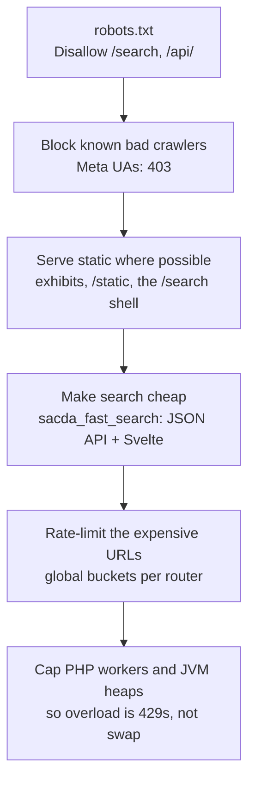

Crawlers took the site down four times in 2026 (2026-08-18, 08-25, 10-26 and 10-29). In
every case the cause was the same: **faceted search URLs are endless, each one is a cache
miss, and there are only 5 php-fpm workers on 2 cores.** The protection is layered so
that cheap requests stay cheap and expensive ones are capped.

## The layers

| Layer | What | Where |
|---|---|---|
| robots.txt | Adds `Disallow` rules for faceted `/search` and `/api/`. Core's `/search/` rule has a trailing slash and doesn't match `/search?f[0]=…` | `assets/patches/robots_append.txt`, baked into the image |
| Crawler block | `block-meta` router: Meta's crawler user agents, and Facebook's link previewer on facet URLs, get `deny-all` | `conf/traefik/drupal.yml` |
| Static `/search` | Anonymous `GET` of `/search` is a static page from nginx; the Svelte app then calls `/api/search` | `drush sacda-fast-search:shell`, `exhibits` nginx |
| Cheap search | `/api/search` costs about 0.024 CPU-seconds against 0.13 for the old view | [Search](/docs/islandora/operations/search/) |
| Rate limits | Facet depth, facet location and old CollectiveAccess URLs each have their own bucket | [Traefik and rate limits](/docs/islandora/operations/traefik-and-rate-limits/) |
| Resource caps | `pm.max_children=5`, JVM heap caps, log size caps | `docker-compose.yml` |

## Why the buckets are global

The campus proxy hides client addresses (see [Networking](/docs/islandora/operations/networking/)),
so a limit can't target one crawler. During a crawl some real visitors get a 429 as well.
This is deliberate: a 429 for a few visitors is better than a 502 for everyone.

## When a crawl happens

1. Confirm it: 502s or hangs, pinned php-fpm workers, faceted URLs in the search access
   log, Traefik returning 429.
2. If static routes work but Drupal routes hang, run `docker compose restart drupal`.
3. Don't loosen the limits. If one crawler stands out by user agent, add it to
   `block-meta`'s pattern. The Traefik files hot-reload, so no restart is needed.
4. Record it in the [Incident log](/docs/islandora/operations/incident-log/).

The `traffic-monitor` container keeps 5-minute metrics for the comparison afterwards. See
the [Runbook](/docs/islandora/operations/runbook/).

## Not in place

- **No CDN or WAF.** Cloudflare or a similar service in front would need UFV IT, because
  they own DNS and the proxy.
- **No per-IP limits**, until the proxy forwards real client addresses.
- **No CAPTCHA or proof-of-work challenge** (Anubis or similar). One would be needed only if
  crawlers start ignoring the limits at volume.
