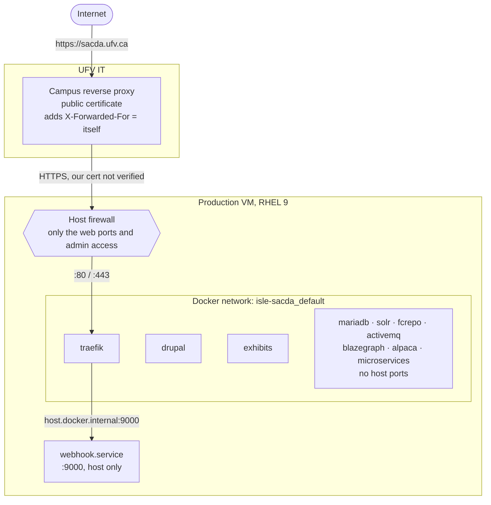
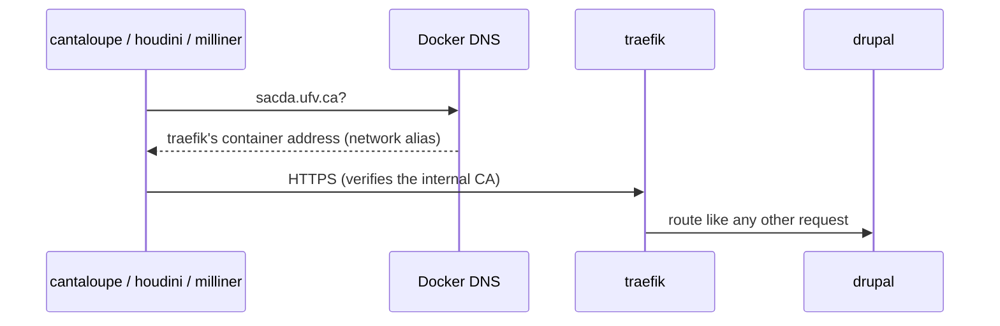

This page shows how traffic moves around the production stack. Routing rules and rate
limits are covered in [Traefik and rate limits](/docs/islandora/operations/traefik-and-rate-limits/),
and certificates in [Certificates](/docs/islandora/operations/certificates/).

## Layers

| Layer | Owned by | Notes |
|---|---|---|
| DNS for `sacda.ufv.ca` and the public certificate | UFV IT | Points at the campus proxy, not at the VM |
| Campus reverse proxy | UFV IT | Terminates public TLS and does not verify our certificate. Upload size and timeout limits live here (large video uploads once failed with 504s until IT raised the timeout) |
| Host firewall | UFV IT and the service account | Only the web ports and administrative access are open. Change requests go to UFV IT |
| Docker network | `isle` repo | One default bridge network per Compose project. Only `traefik` publishes host ports |

## What is exposed

Only **`traefik`** publishes ports to the host (`80` and `443`). Everything else is
reachable only from inside the Compose network.

- **`drupal`, `exhibits`** are reached through Traefik routers.
- **Fedora** has a router on `fcrepo.<domain>`, but that hostname only resolves inside the
  Compose network (see below). The campus proxy forwards only the public domain, so Fedora
  is internal-only.
- **Solr, ActiveMQ and Blazegraph** only get routers when `DEVELOPMENT_ENVIRONMENT=true`,
  so they are never routed on PROD.
- **Traefik metrics** are served on the internal entrypoint `:8082`, which has no host port.
  The `traffic-monitor` container reads them.
- **The deploy webhook** listens on host port `9000`. Traefik forwards `/hooks/` to it
  through `host.docker.internal`. Every call needs the webhook token, and the router is
  limited to 6 a minute.

## Internal hostnames and the hairpin

Traefik's container has network aliases for `${DOMAIN}`, `fcrepo.${DOMAIN}`,
`solr.${DOMAIN}`, `activemq.${DOMAIN}` and `blazegraph.${DOMAIN}`. Inside the Compose
network, those names resolve to Traefik itself.

This "hairpin" keeps service-to-service traffic off the campus proxy. It also means:

- Services fetch files from `https://<domain>/...` and **verify Traefik's internal
  certificate** against the mounted `CERT_AUTHORITY`. If that certificate expires,
  browsers keep working (the proxy doesn't check it) but every JVM service fails.
  See [Certificates](/docs/islandora/operations/certificates/).
- Rate limits apply to hairpin traffic too, because it goes through the same routers.

## Client IPs and forwarded headers

The campus proxy puts its own address in `X-Forwarded-For`. Traefik trusts forwarded
headers only from the configured frontend addresses (`FRONTEND_IP_*` in `.env`). The
result is that **no client IP is visible**: logs show the proxy, and every rate limit is one
global bucket. See [Bot protection](/docs/islandora/operations/bot-protection/).

## TLS inside the stack

- Traefik serves a certificate from `certs/`, mounted as Docker secrets
  (`CERT_PUBLIC_KEY`, `CERT_PRIVATE_KEY`), with TLS 1.2 or newer (`conf/traefik/00-tls.yml`).
- Microservices authenticate to Drupal and Fedora with **JWTs** (`JWT_ADMIN_TOKEN`,
  `JWT_PUBLIC_KEY` secrets), not network position.
- `certs/` and `secrets/` aren't in git; they are kept on each server.

## Outbound traffic

The VM makes outbound calls to:

- **GHCR and Docker Hub**, for image pulls during deploys.
- **GitHub**, for `git pull` during `make deploy-auto` and for exhibit builds.
- **Authority sources** (id.loc.gov and others) from `authority_resolver` cron, and the
  Mailchimp RSS feed for `/newsletter`.

## DEV

A developer instance runs on a maintainer's machine behind a Cloudflare tunnel
(`conf/cloudflared/`). The tunnel reaches `traefik:443` inside Compose and skips
certificate checks because the dev certificate is self-signed. See
[Local development](/docs/islandora/development/local-development/).
