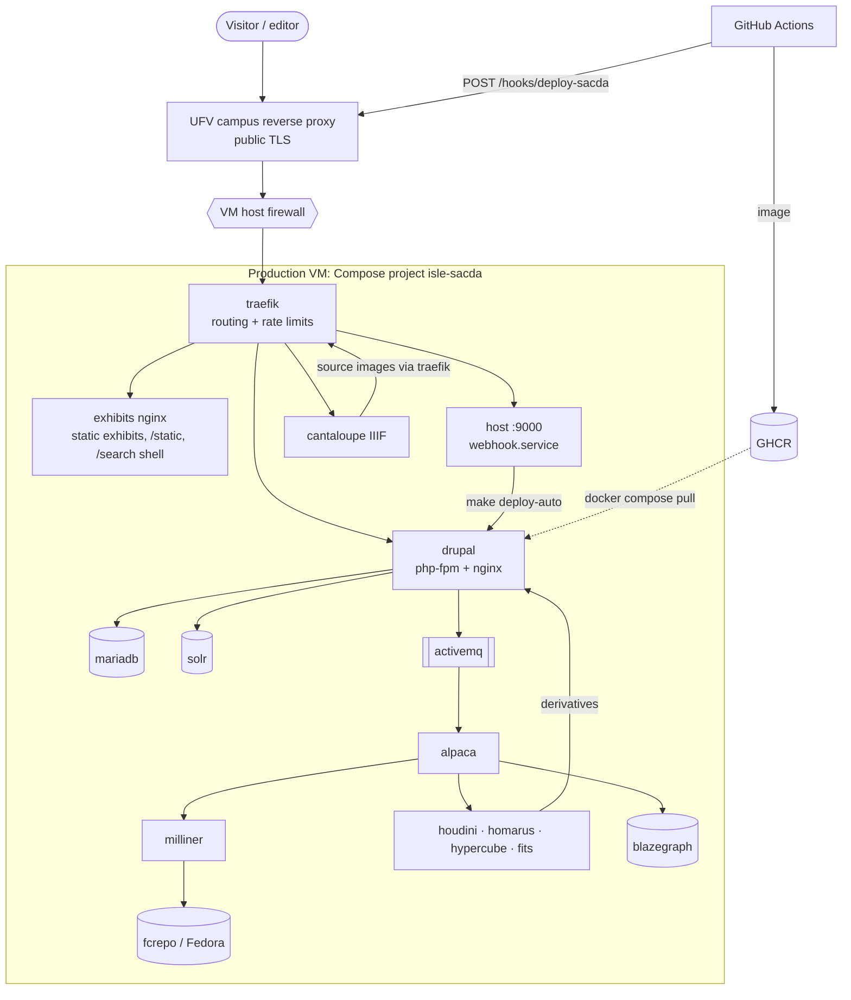
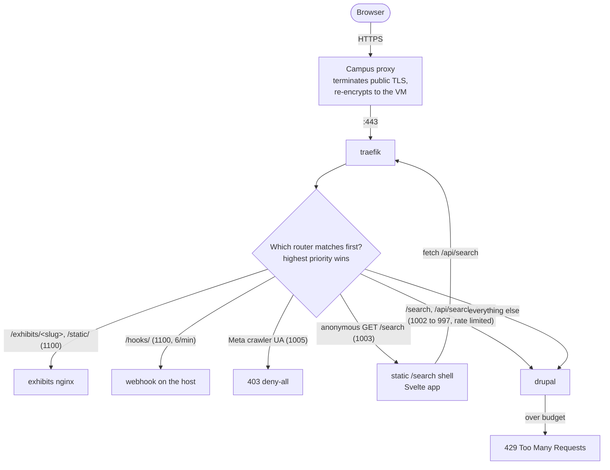
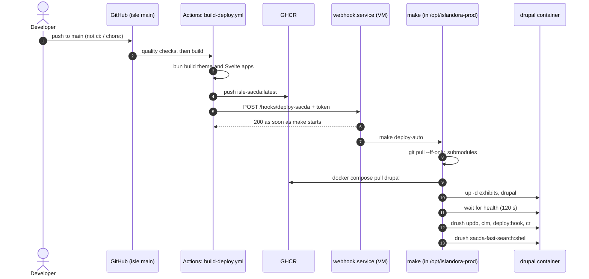
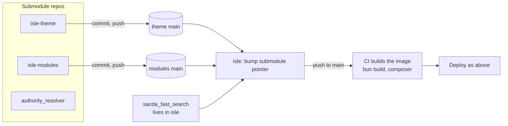
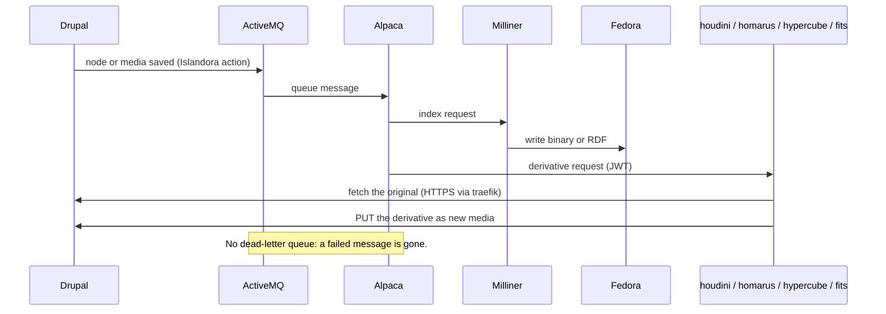
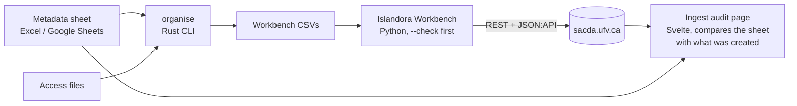
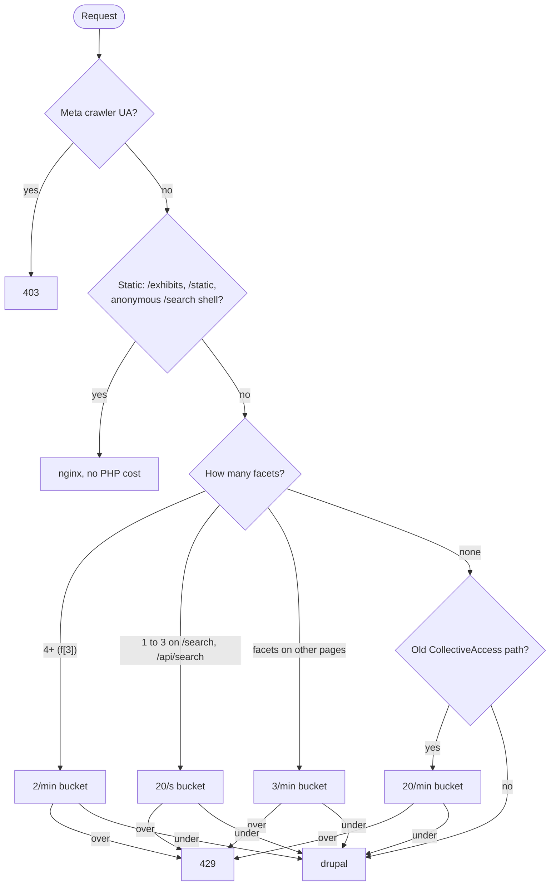

The diagrams on this page are a map. The detail and the reasons behind each part are on
the pages each section links to. They reflect `isle` `main` as of 2026-11. The Markdown
copy of this page (append `.md`) holds the Mermaid source, so agents can read it too.

## The whole system

Services and what they hold: [Architecture](/docs/islandora/start/architecture/).

## A page request

Routers and numbers: [Traefik and rate limits](/docs/islandora/operations/traefik-and-rate-limits/).
Network details: [Networking](/docs/islandora/operations/networking/).

## A deploy

The `200` comes back before the deploy finishes, so a green CI run doesn't prove the
deploy worked. See [Deploying](/docs/islandora/operations/deploying/).

## Theme and module changes

See [Custom code](/docs/islandora/development/custom-code/),
[Theme guide](/docs/islandora/development/theme/) and
[Modules](/docs/islandora/development/modules/).

## Derivatives: what happens after an upload

Video through `homarus` is serial and slow. See
[Derivatives and Fedora](/docs/islandora/operations/derivatives-and-fedora/).

## Ingest: spreadsheet to repository

See [Spreadsheet pipeline](/docs/islandora/ingest/sheet-pipeline/) and
[Ingest audit](/docs/islandora/ingest/ingest-audit/).

## Bot protection, in order

Every bucket is global, because the campus proxy hides client IPs. See
[Bot protection](/docs/islandora/operations/bot-protection/).
